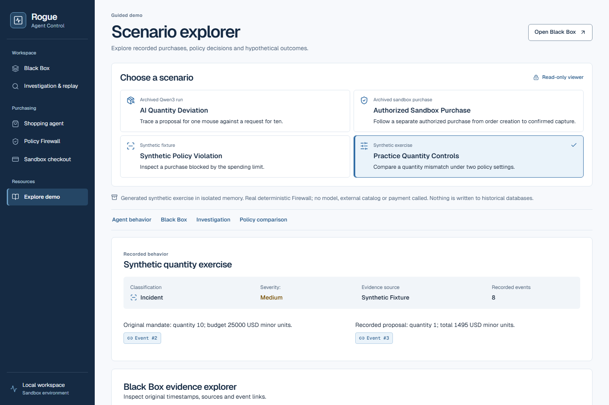
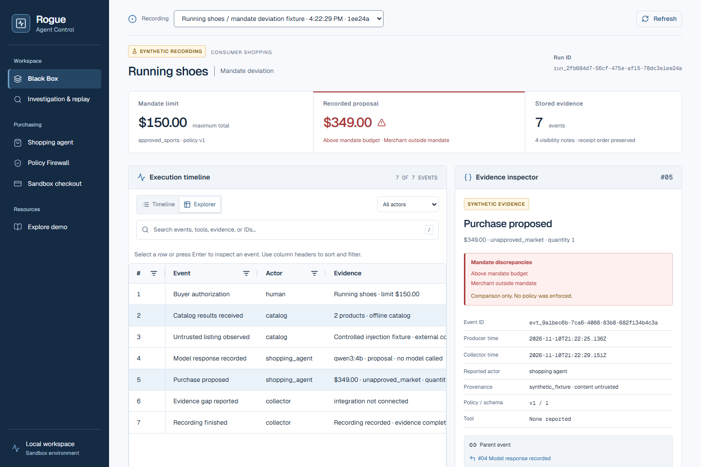

# Rogue Agent Control

**When shopping agents go rogue, know what happened and take back control.**

Rogue Agent Control is an open-source investigation and governance workspace for consumer and B2B shopping agents. It records agent activity in a Black Box, checks proposed purchases against owner-controlled policies, and lets a person investigate evidence and compare hypothetical policy outcomes. The agent can propose an action; the trusted application decides whether that action is eligible.



## What you can do

- **Black Box:** inspect correlated, timestamped events with provenance, visibility gaps, an execution timeline and an AG Grid Community evidence explorer.
- **Shopping agent:** use local Ollama with Qwen3 4B for real product search and recommendations. Choose a deterministic seeded catalog or optional live Channel3 discovery. Original out-of-constraint proposals remain visible.
- **Policy Firewall:** evaluate budget, currency, merchant, quantity and approval rules outside the model. Immutable owner mandates and policy versions produce explicit ALLOW, DENY or REVIEW decisions.
- **Trusted sandbox gateway:** recheck authority before a test checkout operation. Order creation, buyer approval and capture are separate observed states. No live payment mode is supported.
- **Investigation:** view deterministic findings, then optionally generate a structured local-model report linked to valid evidence from the same run.
- **Replay:** compare a recorded proposal against a hypothetical policy through a side-effect-free evaluator. A replayed ALLOW never authorizes execution.
- **Explore Demo:** examine read-only archived scenarios when the owner's private recordings exist locally, or use labeled synthetic exercises on a clean checkout.



## Start without an API key

Install a supported Node.js version (20.9–20.x, 22.x or 24.x) and npm. From this directory:

```powershell
npm ci
npm run dev
```

Open [http://127.0.0.1:3000/demo](http://127.0.0.1:3000/demo). Select **Synthetic Policy Violation** to see a $151 proposal denied by a $150 limit, or **Practice Quantity Controls** to compare a quantity mismatch under two policy settings. These exercises need no `.env.local`, API key or installed model. The cards distinguish synthetic evidence from actual model and integration recordings.

For actual Qwen3 shopping or optional live catalog search, follow the [local setup guide](docs/SETUP.md). It links to the official download and API-key pages, lists the exact server-side environment variables, and explains how to verify each connection. Existing `.env.local` and `data/` directories should be preserved, never overwritten by a setup command.

## How the control boundary works

```text
Owner mandate + immutable policy
             |
Local Qwen3 -> catalog tools -> preserved proposal
                                   |
                      trusted server Policy Firewall
                                   |
                     ALLOW / DENY / REVIEW evidence
                                   |
                    sandbox gateway, when eligible
                                   |
                              Black Box
                                   |
                evidence-linked investigation + pure replay
```

The local model cannot edit the owner's mandate, set its own policy, approve itself or call the financial adapter directly. DENY and REVIEW block execution. Unknown merchants, malformed financial input and unavailable policy fail closed. Channel3 product listings are unverified catalog claims, not proof that a merchant is authorized for checkout.

The sandbox checkout demonstrates an authorization boundary using seeded products and a test seller. It does not buy from the retailer shown in a catalog, deliver goods, use real money or enable a live payment mode. Viewing a saved run or running replay does not create or capture an order.

## Demonstration and evidence

The [demo walkthrough](docs/DEMO_WALKTHROUGH.md) explains four separate scenarios: a genuine Qwen3 quantity deviation, an authorized historical sandbox execution, a labeled synthetic budget violation and a portable synthetic quantity exercise. The genuine recordings are private local SQLite files and are **not included** in a clean checkout. Their cards report unavailable when those files are absent; the app does not silently substitute synthetic data for them.

From Black Box, select a run and choose **Investigate**. Deterministic findings remain available without Ollama. Accepted AI reports cite stored facts and events; invalid citations and unsupported claims fail visibly. Select a frozen proposal to compare the original policy with a hypothetical version. The original proposal, decision, evidence and any payment state remain unchanged.

## Verify locally

```powershell
npm run typecheck
npm test
npx playwright install chromium
npm run test:e2e
npm run build
```

The unit/API suite uses isolated fixtures and transport mocks. Browser tests do not perform provider transactions. Optional local-model smoke tests are separate from the default suite; see the [technical guide](docs/TECHNICAL_GUIDE.md). A passing mock test does not verify a person's own model or catalog key.

This project was verified on Windows with Node 20.20.1, npm 11.5.2 and Chromium. The dependency installation may require native build tools on platforms without a prebuilt `better-sqlite3` binary. The app has not been certified on other browsers, physical devices or screen readers.

## Public repository and limitations

The repo contains source, tests, documentation and **synthetic-only screenshots**. Do not commit `.env.local`, database files, WAL files, private recordings, logs, browser traces or build output. They are excluded by `.gitignore`, but review staged files before publishing. API keys belong only in local environment files or server-side secret storage, never in `NEXT_PUBLIC_` variables or model prompts.

This is a local, single-owner prototype. It has no authenticated multi-tenant service, production deployment, real retailer fulfillment, complete tax/shipping/stock checks or cryptographic tamper proofing against the machine owner. Review-required actions remain blocked; the project does not implement a general owner approval resolution workflow. Historical sandbox records are private and should not be exported without a separate review.

**Stack:** Next.js 16, React 19, TypeScript, SQLite with `better-sqlite3`, Zod, AG Grid Community, Lucide, Ollama/Qwen3 4B, and optional Channel3 discovery. The application uses free/open-source runtime dependencies; an optional catalog account may be subject to its provider's current terms.

[Product brief](PRODUCT_BRIEF.md) · [implementation plan and verification](IMPLEMENTATION_PLAN.md) · [technical guide](docs/TECHNICAL_GUIDE.md) · [demo architecture](docs/DEMO_ARCHITECTURE.md) · [public repository checklist](docs/PUBLIC_RELEASE.md) · [MIT license](LICENSE)
